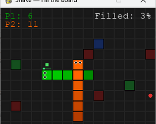

# Snake: Fill the Board

Classic Snake with a twist. Every piece of food you eat fills its cell for good, and the goal is to fill the whole board. Play solo for a high score, or race a friend for the food.

**[Play in your browser (itch.io)](https://cloudbv.itch.io/snake-classic-with-a-twist)** · **[Project page](https://cloudbv.github.io/2p-Snake-Calm/)**



## The twist

- **No dying.** Edges wrap around, and snakes pass through themselves and each other.
- **Food fills the board.** Each cell you eat from is filled permanently.
- **Win by filling it.** The game ends when every cell is filled.

## Food

| Food | Points | What it does |
| --- | --- | --- |
| Red circle | 1 | Always on the board. Fills two cells when eaten (its own plus one random extra). |
| Green square | 5 | Jumps to a new spot every 5 seconds and shrinks as its timer runs out. Fills one cell. |
| Blue triangle | 5 | Appears each time the total score passes another 10 points. Gives a speed boost that stacks and wears off after 10 seconds. |

The game speeds up as you score.

## Modes and controls

| Mode | Controls | How it ends |
| --- | --- | --- |
| 1 Player | P1: `W` `A` `S` `D` | Fill the board and beat your best score. |
| 2 Players | P1: `W` `A` `S` `D`, P2: arrow keys | Highest score when the board fills wins. |

`Space` pauses (1 player only). `Q` or `Esc` returns to the menu at any time. `R` restarts from the end screen.

## Board sizes

Small (15×12), Medium (30×25) and Large (45×35). Your best score is saved separately for each size in `snake_highscore.json`, next to the script.

## Run it locally

You need Python 3 and pygame.

```bash
pip install pygame
python snake.py
```

## Customize

The tunable values sit at the top of the script with comments:

- Board sizes: add a row to `PRESETS`
- Starting speed and speed cap: `FPS_START`, `FPS_MAX`
- Blue boost strength and decay time: `BLUE_BOOST`, `BLUE_DECAY`
- How often green food moves: `GREEN_CYCLE`
- Every color in the game: the colors block

## Built with

Python and [pygame](https://www.pygame.org). The browser version is packaged with [pygbag](https://pygame-web.github.io).
